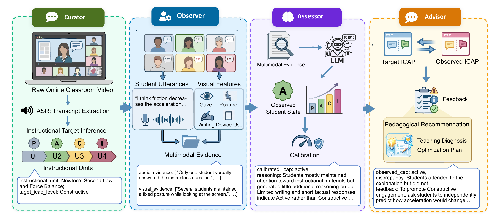
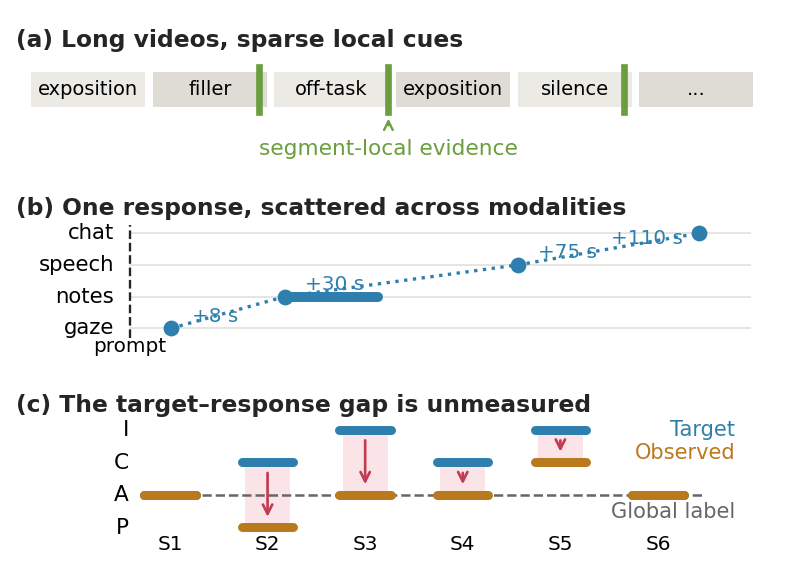
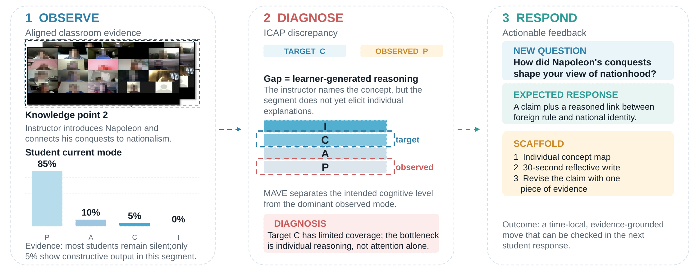
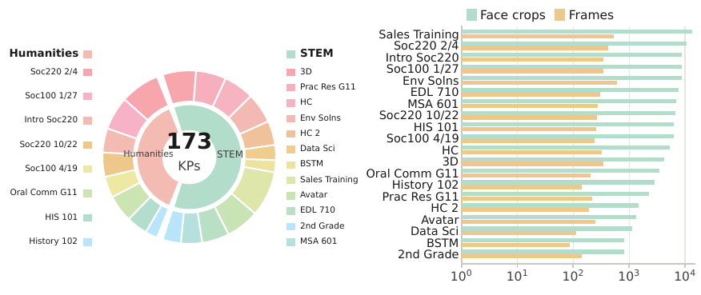

# MAVE: A Multi-Agent Framework for Grounded Pedagogical Feedback from Online Class Videos
This repository contains the implementation of **MAVE**, a collaborative multi-agent framework designed to transform raw multimodal classroom data into structured, 
pedagogically actionable optimization signals.
## Overview
Effective instructional optimization in online education relies on fine-grained, authentic feedback.However, current analytics are often limited to behavioral labeling and fail to generate actionable insights. 
This project proposes a methodology that shifts focus from simple classification to a **feedback-to-optimization paradigm**. By decomposing long-duration analysis into interacting subtasks, the framework achieves robust denoising and translates low-dimensional numerical behavior into explainable textual guidance.

---
## Framework Architecture

*The Curator infers instructional targets, the Observer extracts aligned student evidence, the Assessor estimates student states with optional Passive refinement, and the Advisor turns the target–state gap into grounded teaching feedback.*

## Task and Teaching Feedback

*Sparse local cues, delayed multimodal responses, and segment-specific target–response gaps.*

*The target–state gap guides a teaching revision with a concrete prompt, scaffold, and observable success criterion.*

## MAVEBench

*Composition of 173 knowledge-point segments and per-video face crops and frames after cleaning.*

---
*This project is part of ongoing research into fine-grained feedback-to-optimization paradigms in intelligent education.*
